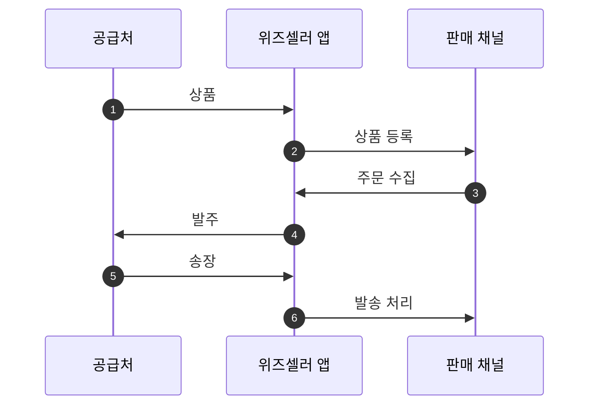
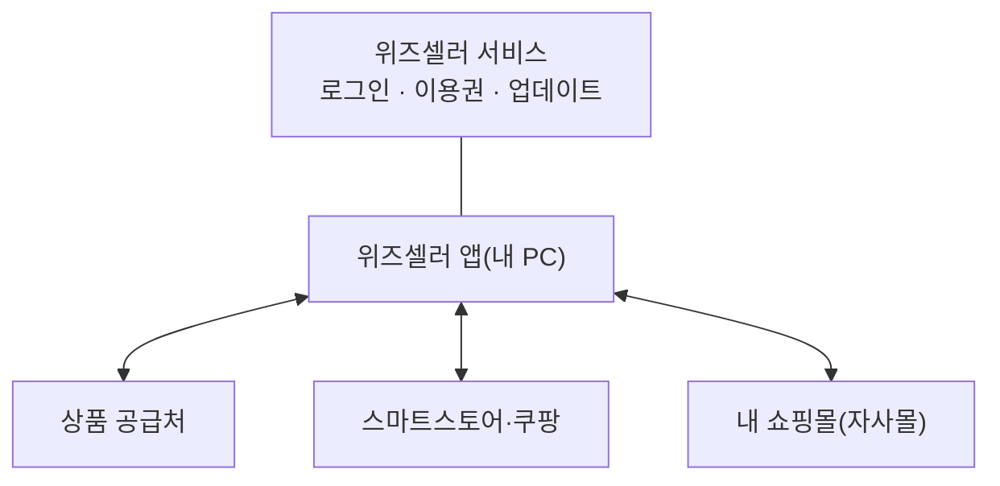

# WWIZSELLER · 위즈셀러

**팔 만한 상품을 찾는 일부터, 판매와 주문 이행까지.**

위즈셀러는 무재고 판매자를 위한 Windows 데스크톱 앱입니다.
판매 조건과 수익 목표를 정하면, AI 상품 소싱부터 나만의 쇼핑몰 운영,
여러 판매 채널의 상품·주문·배송 관리까지 하나의 앱으로 연결합니다.

[최신 버전 다운로드](https://github.com/wwizcorp/wwizseller/releases/latest) ·
[버전별 변경사항](https://github.com/wwizcorp/wwizseller/releases) ·
[공식 웹사이트](https://wwizseller.kr)

## 위즈셀러의 특장점

- **재고 부담을 줄이고 상품 판매를 시작하세요.**
  주문이 들어오면 공급처 발주와 배송으로 바로 이어지는 무재고 판매를 운영할 수 있습니다.

- **내 브랜드의 독립 쇼핑몰을 운영하세요.**
  나만의 도메인과 브랜드를 담은 자사몰을 개설하고, 상품부터 주문까지 앱에서 관리할 수 있습니다.

- **팔 만한 상품은 AI가 찾아줍니다.**
  인기 검색어, 홈쇼핑 상품, 콘텐츠 속 유행과 판매 성과에서 수요를 발견하고,
  설정한 가격·마진·배송 조건에 맞는 상품을 찾아 선정과 등록까지 연결합니다.

- **하나의 상품을 여러 판매 채널로 넓혀 보세요.**
  내 쇼핑몰, 스마트스토어, 쿠팡에 맞춰 상품을 등록하고 가격·재고·판매 상태를 함께 관리합니다.

- **주문이 들어온 뒤의 반복 업무도 자동으로 이어집니다.**
  주문 수집, 공급처 발주, 송장 전달과 배송 상태 갱신을 연결하고,
  앱을 다시 실행하면 중단된 업무를 이어서 처리합니다.

- **판매 결과를 다음 수익 기회로 연결하세요.**
  비용과 실제 손익을 확인하고, 판매·취소·반품 결과를 다음 상품 선정과 운영에 반영합니다.

## 데스크톱 앱을 중심으로 이어지는 판매 운영

운영자는 판매 조건을 정하고, 위즈셀러는 상품을 찾는 일부터 주문과 배송을 잇는 일까지 처리합니다.
직접 고른 상품을 등록할 수도 있고, 조건에 맞는 상품 발굴을 AI에 맡길 수도 있습니다.

### 상품에서 주문·배송까지

공급처는 위탁판매용 상품과 배송을 제공하는 도매 업체를,
판매 채널은 내 쇼핑몰·스마트스토어·쿠팡 등을 뜻합니다.
공급처에서 고객에게 상품을 배송하면 위즈셀러가 송장과 배송 상태를 판매 채널에 전달합니다.

**수요 발견 → 상품 선정 → 채널별 판매 → 주문·배송 → 성과 반영**이 하나의 흐름으로 이어집니다.

### 내 PC의 위즈셀러로 연결되는 운영 공간

위즈셀러 서비스는 로그인·이용권 확인과 업데이트를 지원합니다.
내 PC의 위즈셀러 앱이 공급처·판매 채널·자사몰을 직접 연결해 상품과 주문을 관리합니다.
자사몰은 웹에서 운영되며, 데스크톱 앱이 실행되는 동안 연결된 판매 채널의 자동화 업무를 처리합니다.

## 다운로드와 이용 안내

- **지원 플랫폼:** Windows 데스크톱
- **프로그램 이용:** 위즈셀러 계정과 사용 가능한 이용권 필요
- **설치 파일·변경사항:** [Releases](https://github.com/wwizcorp/wwizseller/releases)
- **공식 웹사이트:** [wwizseller.kr](https://wwizseller.kr)

최신 릴리스에서 Windows 설치 파일을 내려받아 실행하세요.
각 릴리스에는 변경사항과 설치·업데이트 안내가 함께 제공됩니다.
이 저장소는 제품 안내와 공식 배포를 위한 공간이며, 애플리케이션 소스코드는 포함하지 않습니다.

## 문의와 커뮤니티

질문, 오류 제보와 기능 제안은 [위즈셀러 커뮤니티](https://github.com/wwizcorp/wwizseller/discussions)에 남겨주세요.
판매 운영 경험과 노하우도 함께 나눌 수 있습니다.
